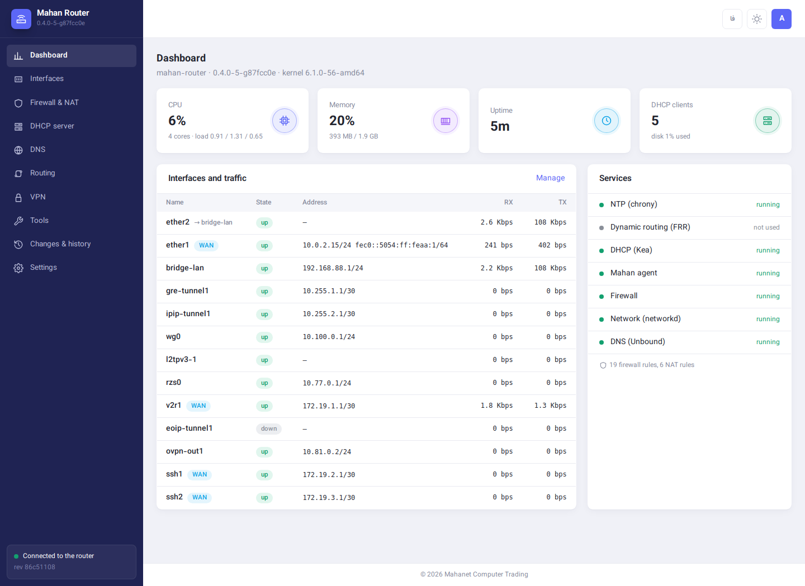
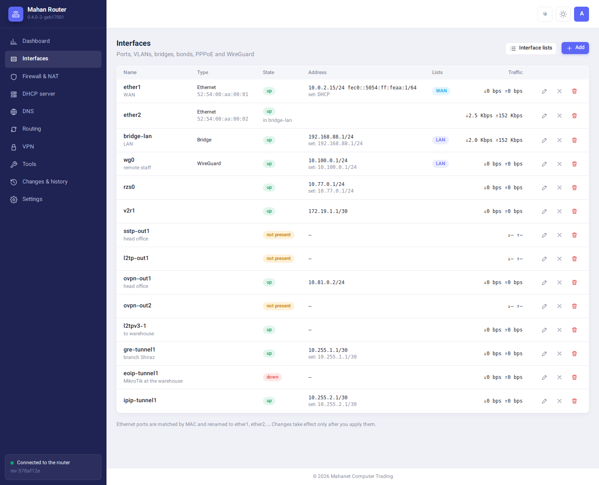
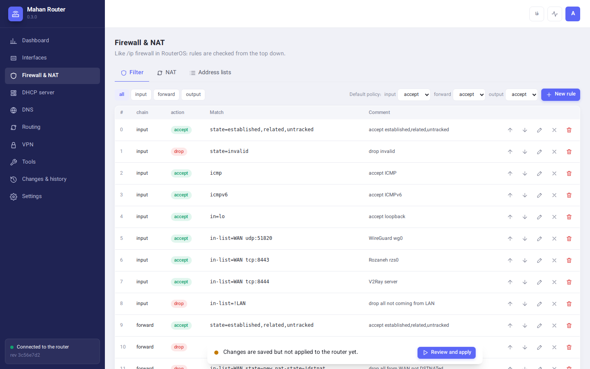
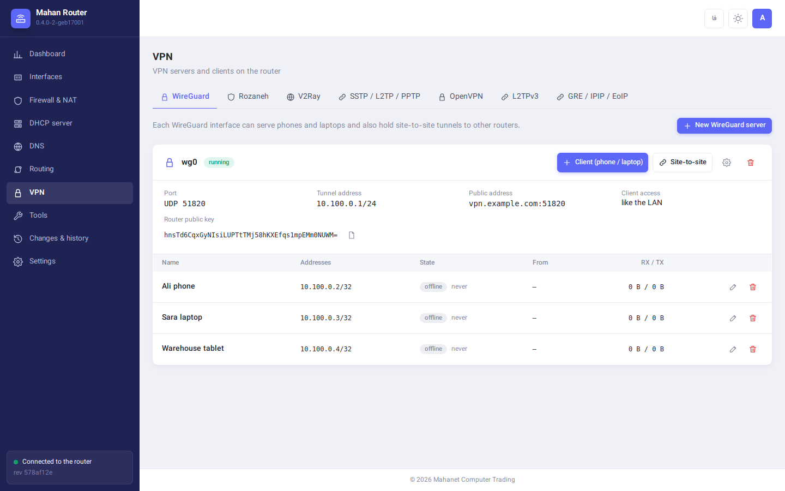
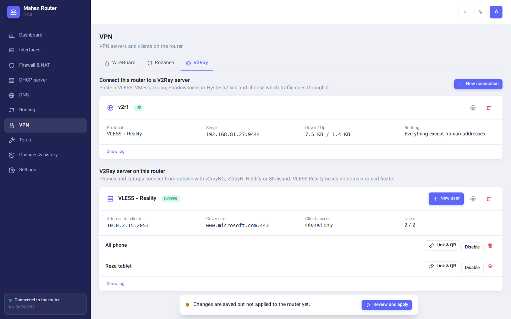
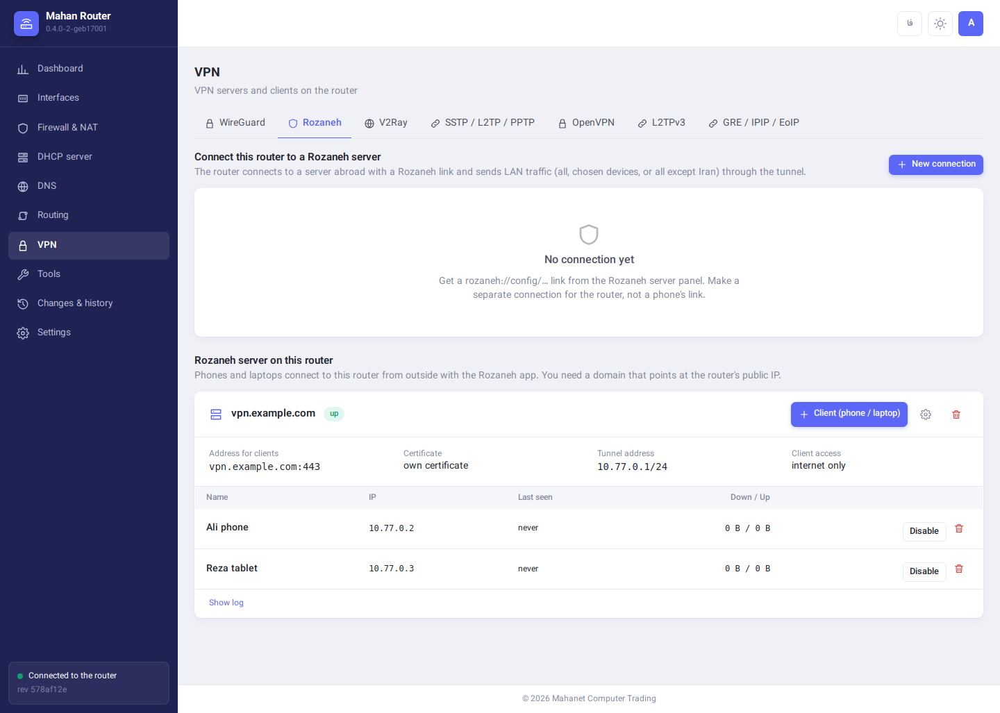
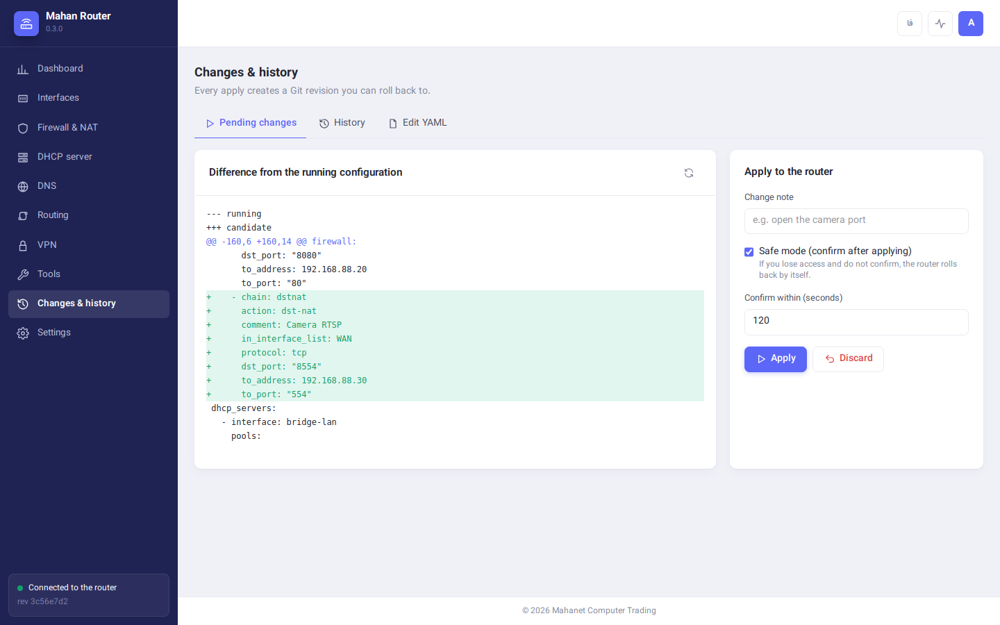

# Mahan Router

A Linux-based router OS meant to replace MikroTik RouterOS on standard x86
hardware and virtual machines. Debian 12 underneath, one declarative YAML
config, Git history with commit-confirm, and a Persian/English web panel.



**Install it:** [docs/INSTALL.md](docs/INSTALL.md) (English) ·
[docs/INSTALL.fa.md](docs/INSTALL.fa.md) (فارسی)

## Features

- **Interfaces:** Ethernet ports renamed to `ether1…` by MAC, VLAN, bridge,
  bond, PPPoE client, loopback, CAKE shaping, and interface lists (`WAN`,
  `LAN`) like RouterOS.
- **Firewall and NAT:** nftables with RouterOS-style chains and matchers,
  address lists (static and dynamic with timeout), port forwarding, and live
  hit counters.
- **Services:** DHCP server (Kea) with reservations, DNS cache (Unbound),
  NTP (chrony), static routes, and OSPF/BGP (FRR).
- **VPN:**
  - WireGuard: server with QR client configs, site-to-site.
  - Rozaneh: our own anti-DPI VPN, client and server.
  - V2Ray via sing-box: VLESS/Reality, VMess, Trojan, Shadowsocks and
    Hysteria2 client; VLESS-Reality or Shadowsocks-2022 server.
- **Policy routing:** send all LAN traffic, chosen devices, or everything
  except Iranian addresses through a tunnel, optionally with DNS through the
  tunnel and a kill switch.
- **Safe changes:** every change is a candidate until applied. Applying in
  safe mode rolls back by itself unless confirmed. Every apply is a Git
  revision you can diff and roll back.
- **Web panel** (HTTPS, Persian and English), **CLI** (`mrctl`) and a
  **REST API**.
- **ISO** with an installer for BIOS and UEFI, VMware and QEMU guest tools.

| | |
|---|---|
|  |  |
|  |  |
|  |  |

> **Status:** early (0.3.0). The ISO is tested on VMware and in QEMU (BIOS and
> UEFI), not yet on physical hardware. There is no IPsec/OpenVPN, no per-IP
> queues and no A/B update yet. [docs/STATUS.md](docs/STATUS.md) lists what
> is built and what is still missing. The design is in
> [docs/ARCHITECTURE.fa.md](docs/ARCHITECTURE.fa.md) (Persian).

## How it works

```
             ┌──────────── management plane ────────────┐
  mrctl ───► │ REST API (Unix socket, or TCP with token) │ ◄─── web panel
             └───────────────────┬──────────────────────┘
                                 │
             ┌─────────── control plane: mahan-agent ────────────┐
             │ YAML config ─► validate ─► render ─► precheck ─►   │
             │ write files ─► reload changed services ─► Git commit│
             │ commit-confirm timer ─► automatic rollback          │
             └───────────────────┬───────────────────────────────┘
                                 │ rendered files
  ┌──────────────┬──────────────┼──────────────┬────────────┬──────────┐
  nftables       systemd-networkd  FRR (OSPF/BGP) Kea DHCPv4   Unbound    chrony / pppd
  (filter, NAT)  (ports, VLAN,   
                 bridge, bond,
                 WireGuard, CAKE)
```

- **One declarative file** (`config.yaml`) describes the whole device. Every
  commit is a Git revision that you can diff and roll back.
- **Commit-confirm:** `mrctl commit --confirm 120` rolls back automatically
  unless you run `mrctl confirm` in time. A reboot during the window also
  rolls back, so a bad firewall rule cannot lock you out.
- **Safe apply:** every file is first checked by its own service checker
  (`nft -c`, `kea-dhcp4 -t`, `unbound-checkconf`, `vtysh -C`). If reloading
  a service fails, the previous files are put back.
- **RouterOS-style model:** interface names like `ether1`, interface lists
  (`WAN`/`LAN`), address lists (static and dynamic with timeout), filter
  chains `input`/`forward`/`output`, NAT chains `srcnat`/`dstnat`,
  `connection_state`, `connection_nat_state`, and per-rule counters.
- **The agent owns only its own nftables table** (`inet mahan`). Docker and
  other tables are left alone.

## Layout

| Path | Contents |
|---|---|
| `cmd/mahan-agent` | core-agent daemon |
| `cmd/mrctl` | CLI (talks to the agent; `validate`/`render` also work offline) |
| `internal/config` | schema, strict YAML parsing, validation, factory default |
| `internal/render` | pure renderers: nftables, networkd, Kea, Unbound, chrony, FRR, pppd |
| `internal/apply` | precheck, atomic writes, manifest of owned files, service reloads |
| `internal/store` | Git-backed running config + candidate |
| `internal/agent` | commit / confirm / rollback logic |
| `internal/api` | REST API |
| `internal/panel` | web panel server: login, sessions, HTTPS, embedded app (`dist/`) |
| `web/` | web panel source (React + TypeScript) |
| `examples/` | `factory-default.yaml`, `branch-office.yaml` |
| `tests/lab/` | network-namespace end-to-end test |
| `packaging/systemd/` | `mahan-agent.service`, `mahan-pppoe@.service`, Rozaneh and V2Ray units |
| `image/` | ISO build (`build-iso.sh`), QEMU test (`test-vm.sh`), files baked into the image (`overlay/`) |

## Build and test

```bash
make build      # bin/mahan-agent, bin/mrctl
make sing-box   # bin/sing-box (pinned release, sha256-checked)
make rozaneh    # bin/rozaneh, only if ../mahan-vpn exists
make test       # unit tests; checks rendered files with nft/kea/unbound if installed
make lab        # end-to-end test in network namespaces (root)
make cross      # static binaries for amd64, arm64, arm, mips, mipsle
```

The lab (`tests/lab/run.sh`) builds three namespaces (upstream, router,
client) and starts the agent in lab mode. It commits `tests/lab/lab.yaml`
through the API, loads the rendered ruleset into the router namespace, and
then checks:

- masquerade
- port forwarding
- input firewall
- static and dynamic address lists
- rule counters
- confirm timeout rollback
- manual rollback

## ISO image (VMware / bare metal)

```bash
sudo image/build-iso.sh     # dist/iso/mahan-router-<version>-amd64.iso (~335 MB)
sudo image/test-vm.sh all   # QEMU: live boot, LAN client DHCP/DNS/NAT, auto-install, boot disk BIOS + UEFI
```

- The ISO is Debian 12 with the services listed below, `open-vm-tools` and
  `qemu-guest-agent`. It boots a live system, or installs to disk with
  `mahan-install`, which is also a boot menu entry.
- Default login is `root` / `mahan`.
- Out of the box, ether1 is the WAN (DHCP client) and the other ports are
  bridge-lan at 192.168.88.1/24 with DHCP, DNS and NAT.
- Installation steps are in [docs/INSTALL.md](docs/INSTALL.md) and
  [docs/INSTALL.fa.md](docs/INSTALL.fa.md).

## Web panel

`mahan-agent --panel-listen :443 --panel-http :80` (the default on the ISO)
serves the panel at `https://192.168.88.1` from the LAN side. The firewall
factory default does not let the WAN reach it.

- Sign in with `admin` / `mahan`. The panel asks you to change it. Panel users
  are kept in `/etc/mahan-router/panel-users.json` (PBKDF2 hashes) and are
  separate from Linux accounts.
- The certificate is self-signed and is created on first start in
  `/etc/mahan-router/panel.{crt,key}`. Replace the two files to use your own.
- **How edits work:** every form edits the candidate, the same as `mrctl edit`.
  Nothing changes on the device until you click Apply on the Changes page.
  - Apply shows the diff first.
  - By default it uses safe mode (commit-confirm, 120 s): if you lose access
    and do not confirm, the router rolls back.
- **Pages:**
  - Dashboard: CPU, memory, traffic per port, services
  - Interfaces: VLAN, bridge, bond, PPPoE, WireGuard, interface lists
  - Firewall filter/NAT with counters and address lists
  - DHCP: pools, reservations and current leases
  - DNS
  - Static routes, with the live routing table
  - VPN:
    - WireGuard: servers with QR client configs, site-to-site peers, live
      handshake and traffic
    - Rozaneh: see [VPN: Rozaneh](#vpn-rozaneh)
  - Tools: ping, traceroute and DNS lookup
  - Changes: diff, apply, history, rollback and a raw YAML editor
  - Settings: system, NTP and panel users
- **Security:**
  - The session cookie is HttpOnly and SameSite=Strict.
  - State-changing requests also need an `X-Requested-With` header.
  - After 5 failed logins from one IP, that IP is locked out (30 s, growing).
  - The panel sends CSP headers.
- **Source** is in `web/` (React + TypeScript + Tailwind with the shared
  Mahan theme).
  - `make web` builds it into `internal/panel/dist`, which is committed and
    embedded with `go:embed`.
  - For development, run `cd web && npm run dev` against an agent started with
    `--panel-listen 127.0.0.1:8443`.

## VPN: Rozaneh

Rozaneh is our own VPN (Veil protocol, repository `mahan-vpn`). The binary is
built from `../mahan-vpn` by `make rozaneh` and installed as `/usr/sbin/rozaneh`.

- **Client** (`type: rozaneh`, e.g. `rz1`): the router connects to a Rozaneh
  server with a `rozaneh://config/…` link. The panel puts the interface in the
  WAN list, so traffic out of it is masqueraded and new connections from it are
  dropped like from WAN.
  - The config is rendered to `/etc/mahan-router/rozaneh/<name>.json` with
    `full_tunnel: false`.
  - It runs as `mahan-rozaneh-client@<name>`.
  - The router itself decides what goes through the tunnel (policy routes,
    below).
- **Server** (`type: rozaneh_server`, `rzs0`): phones and laptops connect to
  the router from outside.
  - Needs a domain that points at the router's public IP.
  - The certificate comes from Let's Encrypt (TLS-ALPN-01 on port 443), or you
    paste your own.
  - Rozaneh listens on 8443 because the panel holds 443. The panel adds a WAN
    redirect 443→8443 and an input accept for 8443.
  - Anyone without a key sees a built-in "Welcome to nginx" page, unless
    `cover_url` points at a real site.
  - Peers live in the router config (`peers_from_config`). Their traffic and
    last-seen time come from `/var/lib/mahan-router/rozaneh/<name>/state.json`,
    which the server saves every minute.
  - It runs as `mahan-rozaneh-server@<name>`.
- **Policy routes** (`policy_routes`, any tunnel interface): send traffic out
  of a tunnel instead of the main table. Each route has:
  - `from`: `lan` (the LAN interface list) or `devices` (IPs or prefixes)
  - `except_iran`: Iranian destinations stay direct. The list is
    `internal/render/geoip/ir4.txt`, built from RIPE `delegated-ripencc-latest`
    and embedded in the agent.
  - `dns_via_tunnel`: Unbound's own queries go through the tunnel.
  - `block_if_down`: an unreachable default route in the tunnel table, so the
    traffic stops instead of leaking out the WAN.

  How it works:
  - nftables marks matching packets in `policy_pre` (prerouting, mangle). Only
    the original direction is marked, so port forwards keep working.
    Private, multicast and Iranian destinations are never marked.
  - `ip rule fwmark X lookup main suppress_prefixlength 0`, then
    `fwmark X lookup 1000+i`, where the tunnel's `.network` file puts its
    default route. Specific routes (LAN, static, site-to-site) still win.

## VPN: V2Ray

[sing-box](https://github.com/SagerNet/sing-box) (`/usr/sbin/sing-box`)
runs both sides. Configs go to `/etc/mahan-router/v2ray/`. They are checked
with `sing-box check` before apply, when the binary is installed.

- **Client** (`type: v2ray`, e.g. `v2r1`, unit `mahan-v2ray-client@<name>`):
  - `v2ray.link` is a share link: `vless://` (TLS or Reality), `vmess://`,
    `trojan://`, `ss://` (SIP002, including 2022 ciphers) or `hysteria2://`.
  - Transports: tcp, ws (including `?ed=` early data), grpc, httpupgrade, h2.
    XHTTP is not supported.
  - sing-box makes a TUN interface (`auto_route: false`, gvisor stack,
    172.19.N.1/30). The router routes into it with the same `policy_routes`
    as Rozaneh.
  - sing-box resolves server names with 1.1.1.1 directly, not with Unbound,
    so DNS-via-tunnel cannot loop.
- **Server** (top-level `v2ray_server`, unit `mahan-v2ray-server`):
  - Protocol is VLESS + Reality with xtls-rprx-vision (no domain or
    certificate; the TLS handshake of `reality_target`, default
    www.microsoft.com:443, is borrowed) or Shadowsocks 2022
    (2022-blake3-aes-128-gcm, multi-user).
  - It listens on 8444. The panel adds a WAN redirect from `public_port`
    (default 443) and an input accept rule. The public port must differ from
    the Rozaneh server's.
  - Unless `allow_lan` is set, clients cannot reach private addresses (the
    LAN and the router).
  - User secrets stay in the config, so the panel can show a user's link and
    QR again at any time.
- DNS via the tunnel uses its own mark and table (0x20000+i, table 2000+i),
  which has no kill-switch route. DNS keeps working while a tunnel is down,
  so the tunnel program can resolve its server and reconnect.

## CLI

```bash
mrctl show                     # running config
mrctl edit                     # edit the candidate in $EDITOR
mrctl load my.yaml             # or load a file
mrctl diff                     # running vs candidate
mrctl commit -m "guest vlan" --confirm 120
mrctl confirm
mrctl history
mrctl rollback HEAD~1
mrctl counters                 # hits per rule: f<N> = firewall.filter[N], n<N> = firewall.nat[N]
mrctl render my.yaml --out /tmp/preview   # offline: see the generated files
```

## API (v1)

| Method | Path | Purpose |
|---|---|---|
| GET | `/api/v1/config/running` | running YAML |
| GET/PUT/DELETE | `/api/v1/config/candidate` | candidate YAML |
| POST | `/api/v1/config/validate` | validate body (or candidate) |
| GET | `/api/v1/config/diff` | unified diff |
| GET | `/api/v1/config/render` | files the candidate would produce (secrets masked) |
| POST | `/api/v1/commit` | `{"message","confirm_seconds"}` |
| POST | `/api/v1/confirm` | keep a pending commit |
| GET | `/api/v1/history`, `/api/v1/history/{rev}` | revisions |
| POST | `/api/v1/rollback` | `{"revision": "HEAD~1"}` |
| GET | `/api/v1/status` | revision, pending confirm, `ip -j addr` |
| GET | `/api/v1/firewall/counters` | packets/bytes per rule tag |
| POST | `/api/v1/wireguard/keypair`, `/api/v1/wireguard/pubkey` | X25519 keys (also used for Rozaneh) |
| GET | `/api/v1/wireguard/status` | `wg show all dump`, parsed |
| GET | `/api/v1/v2ray/status` | client tunnels and server unit state, log |
| GET | `/api/v1/rozaneh/status` | unit state, tunnel address, traffic, log, server peers |

The Unix socket needs no token, because it is root-only. The TCP listener
(`--listen`) requires `Authorization: Bearer <token>` from
`/etc/mahan-router/api-token`.

## Runtime dependencies on the device

Debian 12 packages:

- `systemd` (networkd)
- `nftables`
- `kea-dhcp4-server`
- `unbound`
- `chrony`
- `frr`
- `ppp`
- `wireguard-tools`
- `rozaneh` (from `../mahan-vpn`, not a Debian package)
- `sing-box` 1.14.4 (for V2Ray; `make sing-box` fetches the pinned official release)
- `git`

## License

GPL-3.0. See [LICENSE](LICENSE). sing-box, Debian and the other bundled
programs keep their own licenses.
