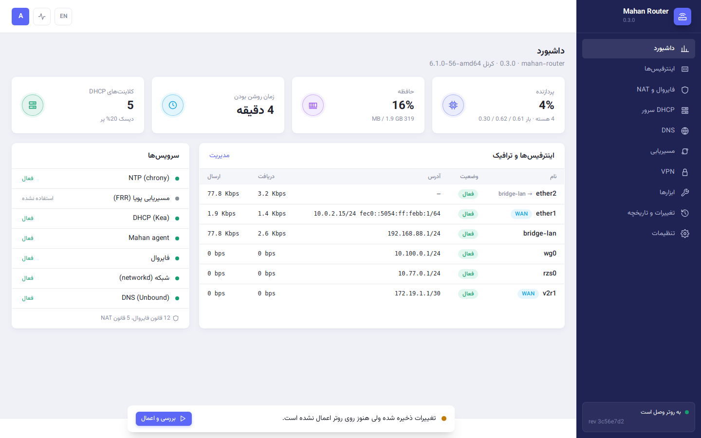
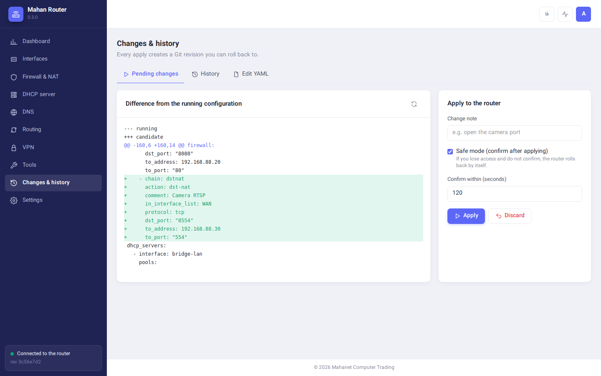
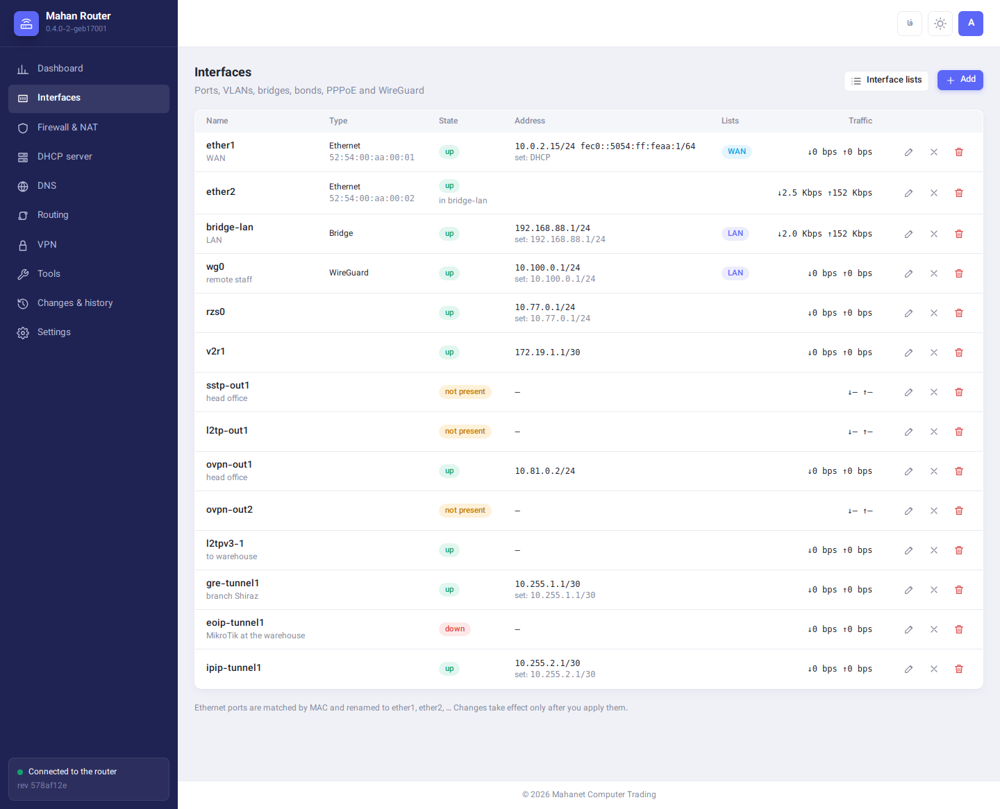
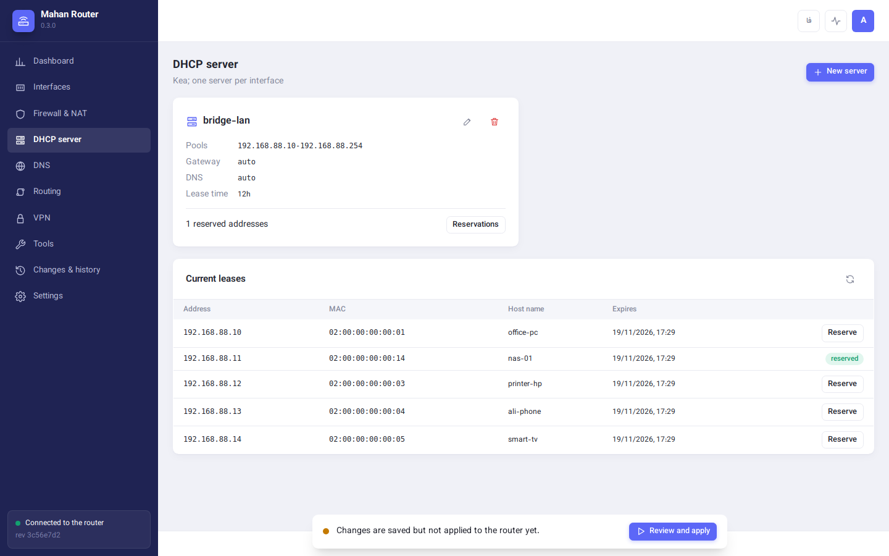
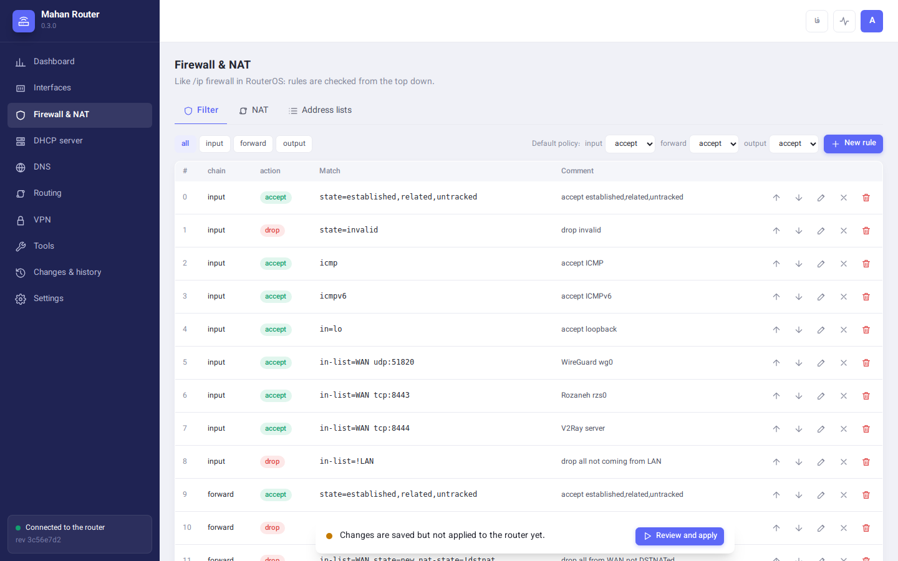
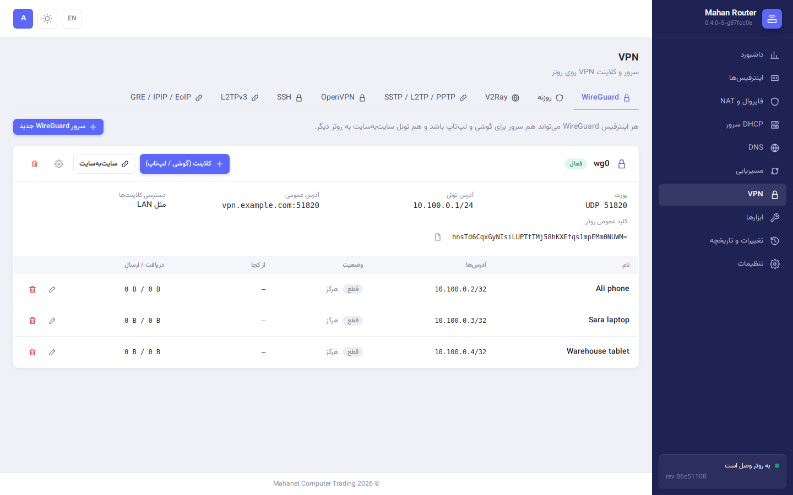

# نصب و راه‌اندازی Mahan Router

این راهنما از یک ماشین خالی شروع می‌کند و به یک روتر آماده می‌رسد: پنل وب، اشتراک اینترنت و در صورت نیاز VPN. نسخه‌ی انگلیسی: [INSTALL.md](INSTALL.md).

## ۱. پیش‌نیازها

| | حداقل | پیشنهادی |
|---|---|---|
| پردازنده | ۱ هسته‌ی x86-64 | ۲ هسته یا بیشتر (رمزنگاری VPN از CPU استفاده می‌کند) |
| رم | ۱ گیگ | ۲ گیگ |
| دیسک | ۸ گیگ | ۱۶ گیگ |
| کارت شبکه | ۲ عدد (WAN و LAN) | هر تعداد؛ کارت‌های اضافه به LAN می‌پیوندند |
| Firmware | BIOS یا UEFI | Secure Boot خاموش |

**تست‌شده روی:**
- VMware Workstation و ESXi (BIOS)
- QEMU/KVM (BIOS و UEFI)

سیستم بر پایه‌ی Debian 12 است، پس Proxmox، Hyper-V و بیشتر کامپیوترهای x86-64 هم باید کار کنند، ولی هنوز تست نشده‌اند.

## ۲. گرفتن فایل ISO

روی Debian 12 یا Ubuntu 22.04 به بعد بسازید:

```bash
sudo apt install -y golang-go mmdebstrap squashfs-tools xorriso grub-common grub-pc-bin grub-efi-amd64-bin mtools dosfstools git curl make
```

```bash
git clone https://github.com/ashayesteh86/MahanRouter.git
```

```bash
cd MahanRouter && sudo image/build-iso.sh
```

- **نسخه‌ی Go:** حداقل 1.27 لازم است. اگر نسخه‌ی توزیع شما قدیمی‌تر است، از https://go.dev/dl بگیرید.
- **خروجی:** فایل در `dist/iso/mahan-router-<version>-amd64.iso` ساخته می‌شود (حدود ۳۶۰ مگ).
- **اینترنت:** ساخت به اینترنت نیاز دارد، چون بسته‌های Debian و نسخه‌ی مشخص sing-box را دانلود می‌کند. sing-box با sha256 بررسی می‌شود.
- **روزنه:** VPN اختصاصی ما فقط وقتی داخل ISO قرار می‌گیرد که سورس آن کنار همین مخزن باشد (`../mahan-vpn`). WireGuard و V2Ray همیشه هستند.

برای تست ISO قبل از استفاده در QEMU، این دستور بوت live، کلاینت LAN، نصب و بوت از دیسک با BIOS و UEFI را بررسی می‌کند:

```bash
sudo image/test-vm.sh all
```

## ۳. ساخت ماشین

ترتیب کارت‌های شبکه مهم است:

- **کارت اول `ether1` و WAN است.** با DHCP آدرس می‌گیرد. آن را به مودم، شبکه‌ی بالادست یا port group اینترنت وصل کنید.
- **بقیه‌ی کارت‌ها (`ether2`، `ether3` و …) LAN هستند.** این کارت‌ها با هم `bridge-lan` را می‌سازند که آدرس 192.168.88.1/24، سرور DHCP، DNS و NAT دارد.

### VMware ESXi / Workstation

| تنظیم | مقدار |
|---|---|
| Guest OS | Linux → Debian GNU/Linux 12 (64-bit) |
| CPU / RAM | ۲ vCPU و ۲ گیگ |
| دیسک | ۸ تا ۱۶ گیگ، SCSI یا SATA |
| Firmware | BIOS یا EFI، با Secure Boot خاموش |
| کارت شبکه | حداقل ۲ عدد از نوع **VMXNET3** (E1000 هم کار می‌کند) |
| CD/DVD | فایل ISO با تیک Connect at power on |

اگر port group سمت LAN روی ESXi چند VLAN یا چند کلاینت پشت روتر دارد، این سه گزینه را روی آن port group روی Accept بگذارید تا bridge درست کار کند:
- Promiscuous mode
- MAC address changes
- Forged transmits

### Proxmox / KVM

یک VM با OVMF یا SeaBIOS بسازید، با دیسک و کارت شبکه‌ی VirtIO. برای LAN یک کارت شبکه‌ی دوم روی bridge جدا (مثلاً `vmbr1`) اضافه کنید.

### کامپیوتر فیزیکی

ISO را روی فلش بنویسید:

```bash
sudo dd if=mahan-router-0.3.0-amd64.iso of=/dev/sdX bs=4M status=progress oflag=sync
```

از فلش بوت کنید. پورت‌ها به ترتیب PCI شماره می‌خورند؛ معمولاً پورت روی مادربرد `ether1` می‌شود.

## ۴. نصب روی دیسک

1. از ISO بوت کنید. منو بعد از ۵ ثانیه **Install Mahan Router to disk** را اجرا می‌کند.
2. نصاب دیسک‌ها را نشان می‌دهد. برای دیسک اول **Enter** بزنید، یا شماره‌ی دیسک را وارد کنید.
3. برای تأیید `YES` را تایپ کنید. **همه‌ی اطلاعات آن دیسک پاک می‌شود.**
4. وقتی پیامش آمد، ISO را جدا کنید و برای ریبوت Enter بزنید.

دیسک با MBR و پارتیشن active نوشته می‌شود و با BIOS و UEFI بوت می‌شود.

## ۵. اولین بوت

روی کنسول آدرس‌های لازم نمایش داده می‌شود:

```
  Mahan Router  mahan-router  (tty1)

  Login: root / mahan   (change it with: passwd)
  WAN  ether1     : 203.0.113.10
  LAN  bridge-lan : 192.168.88.1   web panel: https://192.168.88.1
```

- **ورود به کنسول:** `root` با رمز `mahan`. فوراً با `passwd` عوضش کنید.
- **کلید SSH:** هر نصب در اولین بوت کلید SSH مخصوص خودش را می‌سازد.
- **ساعت:** حتی اگر ساعت ماشین خیلی عقب یا جلو باشد (که در VM زیاد پیش می‌آید)، موقع بوت از NTP درست می‌شود.

تنظیمات پیش‌فرض روتر:
- روی `ether1` با DHCP آدرس می‌گیرد.
- در LAN آدرس‌های 192.168.88.10 تا 254 را می‌دهد.
- DNS را کش می‌کند.
- LAN را به WAN NAT می‌کند.
- مثل فایروال پیش‌فرض میکروتیک، هر اتصال جدید از WAN را می‌بندد.

## ۶. باز کردن پنل وب

یک کامپیوتر را به پورت LAN وصل کنید تا آدرس 192.168.88.x بگیرد، بعد **https://192.168.88.1** را باز کنید.

1. هشدار گواهی مرورگر را بپذیرید. گواهی self-signed است و در اولین اجرا ساخته می‌شود. برای عوض کردنش فایل‌های `/etc/mahan-router/panel.{crt,key}` را جایگزین کنید.
2. با **`admin`** و رمز **`mahan`** وارد شوید.
3. نوار زرد پیام تغییر رمز را نشان می‌دهد. قبل از هر کاری رمز را عوض کنید.
4. پنل فارسی است. دکمه‌ی **EN** بالای صفحه آن را انگلیسی می‌کند.



داشبورد این‌ها را نشان می‌دهد:
- پردازنده، حافظه، زمان روشن بودن و تعداد کلاینت‌های DHCP
- هر اینترفیس با آدرس و ترافیک لحظه‌ای
- وضعیت هر سرویس

## ۷. تغییرات چطور اعمال می‌شوند

این مهم‌ترین نکته است:

1. **هر فرم فقط کانفیگ «کاندید» را عوض می‌کند.** هنوز چیزی روی روتر تغییر نکرده و نواری در پایین صفحه می‌گوید تغییر اعمال‌نشده دارید.
2. **تغییرات و تاریخچه ← تغییرات اعمال‌نشده** تفاوت دقیق را نشان می‌دهد.
3. **اعمال** در حالت امن (به‌طور پیش‌فرض روشن) تغییر را اعمال می‌کند و روتر ۱۲۰ ثانیه منتظر می‌ماند.
4. **تأیید** در نوار بالا تغییر را نگه می‌دارد. اگر دسترسی‌تان قطع شد و نتوانستید تأیید کنید، روتر خودش به کانفیگ قبلی برمی‌گردد. ریبوت در این ۱۲۰ ثانیه هم برگشت می‌دهد.



هر اعمال یک نسخه در Git است:
- **تاریخچه** همه را با نام کسی که تغییر داده نشان می‌دهد.
- **برگشت به این** به هر کدام برمی‌گردد.
- **ویرایش YAML** کل کانفیگ را به‌صورت متن می‌دهد.

## ۸. اتصال اینترنت (WAN)

صفحه‌ی **اینترفیس‌ها** همه‌ی پورت‌ها را نشان می‌دهد. روی `ether1` دکمه‌ی ویرایش را بزنید:

- **DHCP:** پیش‌فرض است و کاری لازم نیست.
- **آدرس ثابت:** *static* را انتخاب کنید و آدرس را وارد کنید (مثلاً `203.0.113.10/24`). بعد در **مسیریابی** مسیر پیش‌فرض `0.0.0.0/0` را با gateway خود اضافه کنید.
- **PPPoE (ADSL/فیبر):**
  1. یک اینترفیس از نوع *PPPoE* با parent برابر `ether1` اضافه کنید و نام کاربری و رمز را وارد کنید.
  2. گزینه‌های *add default route* و *use peer DNS* را روشن کنید.
  3. به جای `ether1`، اینترفیس PPPoE را در فهرست **WAN** بگذارید.



فهرست اینترفیس‌ها مثل میکروتیک کار می‌کند: قوانین فایروال و NAT از **WAN** و **LAN** استفاده می‌کنند، پس فقط کافی است اینترفیس را بین فهرست‌ها جابه‌جا کنید.

## ۹. LAN، DHCP و DNS

- **تغییر آدرس LAN:** `bridge-lan` را ویرایش کنید و بعد pool را در صفحه‌ی **سرور DHCP** درست کنید.
- **پورت‌های بیشتر برای LAN:** آن‌ها را عضو `bridge-lan` کنید.
- **VLAN:** یک اینترفیس *VLAN* روی یک پورت بسازید، به آن آدرس بدهید و برایش سرور DHCP اضافه کنید.
- **سرور DHCP:** pool‌ها و دستگاه‌های فعلی را نشان می‌دهد. با **رزرو**، IP آن دستگاه ثابت می‌شود.
- **DNS:** Unbound برای LAN کش می‌کند و به سرورهای انتخابی شما (به‌طور پیش‌فرض 1.1.1.1 و 8.8.8.8) می‌فرستد. نام ثابت هم می‌شود اضافه کرد.



## ۱۰. فایروال و فوروارد پورت

صفحه‌ی **فایروال و NAT** زنجیره‌های فیلتر (`input`، `forward` و `output`) و NAT (`srcnat` و `dstnat`) را با شمارنده‌ی لحظه‌ای نشان می‌دهد.

- **فوروارد پورت:** یک قانون NAT بسازید با این تنظیمات:
  - chain: `dstnat`
  - in-interface-list: `WAN`
  - پروتکل و پورت
  - action: `dst-nat`
  - آدرس و پورت داخلی
- **باز کردن پورت روی خود روتر:** یک قانون filter با chain `input` و action `accept` بسازید و آن را *بالای* «drop all not coming from LAN» بگذارید.
- **Address list:** برای فهرست مجاز و مسدود. قوانین می‌توانند آن را به‌صورت خودکار و با زمان انقضا پر کنند.



## ۱۱. VPN

صفحه‌ی **VPN** سه تب دارد. هر سه می‌توانند سرور باشند (گوشی و لپ‌تاپ به روتر وصل می‌شوند) و هم کلاینت (روتر به یک سرور خارجی وصل می‌شود و شبکه را از آن رد می‌کند).

> **اگر روتر پشت مودم یا روتر دیگری است،** پورت VPN را روی آن دستگاه به آدرس WAN این روتر فوروارد کنید. بدون این کار، حالت سرور فقط از داخل همان شبکه‌ی بالادست کار می‌کند.



### WireGuard

1. **سرور WireGuard جدید** پورت (51820)، رنج تونل و آدرس عمومی (به‌طور پیش‌فرض IP فعلی WAN) را تعیین می‌کند. این دو گزینه را روشن بگذارید:
   - باز کردن پورت روی فایروال
   - کلاینت‌های VPN مثل LAN باشند
2. در صفحه‌ی تغییرات **اعمال و تأیید** کنید.
3. **کلاینت (گوشی / لپ‌تاپ)** یک کلاینت می‌سازد و این‌ها را می‌دهد:
   - **QR** برای اپ WireGuard
   - فایل `.conf` برای ویندوز و مک

   انتخاب می‌کنید که همه‌ی اینترنت از VPN برود یا فقط شبکه‌ی داخلی. کلید خصوصی کلاینت فقط یک بار نمایش داده می‌شود و روی روتر ذخیره نمی‌شود.
4. **سایت‌به‌سایت** دو روتر را به هم وصل می‌کند. کلید عمومی، آدرس و شبکه‌های طرف مقابل را وارد کنید.

جدول کلاینت‌ها نشان می‌دهد چه کسی وصل است، آخرین اتصال، از کجا وصل شده و ترافیک.

### روزنه

VPN اختصاصی ما. برای شبکه‌ی فیلترشده شبیه HTTPS معمولی است و در قطعی شدید از تونل DNS استفاده می‌کند.

- **کلاینت:** لینک `rozaneh://config/…` را که از سرور روزنه گرفته‌اید وارد کنید و انتخاب کنید چه ترافیکی از تونل برود (بخش بعد).
- **سرور:**
  - دامنه‌ای لازم است که رکورد A آن به IP عمومی روتر اشاره کند.
  - گواهی خودکار از Let's Encrypt گرفته می‌شود، یا گواهی خودتان را وارد کنید.
  - پورت TCP 443 از WAN به روزنه فرستاده می‌شود و پنل برای LAN روی 443 می‌ماند.
  - هر کلاینت یک QR برای اپ روزنه می‌گیرد.
  - کسی که بدون کلید وصل شود یک صفحه‌ی وب معمولی می‌بیند.

### V2Ray

موتور آن [sing-box](https://github.com/SagerNet/sing-box) است.

**کلاینت:** لینک اشتراک را وارد کنید. این‌ها پشتیبانی می‌شوند:
- `vless://` با TLS یا Reality
- `vmess://`
- `trojan://`
- `ss://`، شامل Shadowsocks 2022
- `hysteria2://`

ترنسپورت می‌تواند TCP، WebSocket، gRPC، HTTPUpgrade یا HTTP/2 باشد. XHTTP هنوز پشتیبانی نمی‌شود.

**سرور:**
- **VLESS + Reality** (پیشنهادی): دامنه و گواهی لازم ندارد. بدون کلید، پورت سایت پوششی‌ای را که انتخاب کرده‌اید نشان می‌دهد (پیش‌فرض `www.microsoft.com`).
- **Shadowsocks 2022** گزینه‌ی دیگر است.
- با **کاربر جدید** و بعد **لینک و QR**، لینک برای v2rayNG، v2rayN، Hiddify یا Streisand گرفته می‌شود. لینک هر کاربر را هر وقت خواستید دوباره می‌شود دید.
- کلاینت‌ها فقط اینترنت دارند، مگر این‌که دسترسی به شبکه‌ی داخلی را مجاز کنید.

### انتخاب ترافیکی که از تونل می‌رود

برای کلاینت روزنه و V2Ray:

| گزینه | معنی |
|---|---|
| همه‌ی شبکه‌ی داخلی | همه‌ی دستگاه‌های LAN از تونل می‌روند |
| فقط دستگاه‌های انتخابی | از فهرست DHCP انتخاب کنید یا IP و رنج وارد کنید |
| همه به‌جز آدرس‌های ایران | سایت‌ها و سرویس‌های داخل ایران (بانک، دولت و …) مستقیم می‌روند و بقیه از تونل. فهرست رنج‌های ایران از RIPE است و همراه روتر می‌آید. |
| هیچ | تونل وصل می‌ماند ولی ترافیک LAN را نمی‌برد |

دو گزینه‌ی دیگر:
- **DNS روتر هم از تونل برود:** شبکه‌ی فیلترشده نمی‌تواند جواب جعلی DNS بدهد.
- **اگر تونل قطع شد، این ترافیک هم قطع شود:** بدون این گزینه، موقع قطعی از اینترنت عادی می‌رود.

آدرس‌های محلی، خصوصی و multicast و مسیرهای ثابت شما همیشه از مسیر عادی می‌روند.

## ۱۲. خط فرمان و SSH

SSH فقط از سمت LAN باز است. هر کاری که پنل انجام می‌دهد با `mrctl` هم ممکن است:

```bash
mrctl show
```

```bash
mrctl edit
```

```bash
mrctl diff
```

```bash
mrctl commit -m "guest vlan" --confirm 120
```

```bash
mrctl confirm
```

```bash
mrctl history
```

```bash
mrctl rollback HEAD~1
```

```bash
mahan-selftest
```

برای باز کردن SSH از شبکه‌ی اداره در سمت WAN، این قانون را بالای «drop all not coming from LAN» اضافه کنید (با `mrctl edit` یا صفحه‌ی فایروال):

```yaml
- { chain: input, action: accept, in_interface_list: WAN, src_address: 192.168.1.0/24, protocol: tcp, dst_port: "22", comment: "SSH from office" }
```

فایل `examples/branch-office.yaml` یک نمونه‌ی کامل با VLAN، PPPoE، WireGuard، OSPF و فوروارد پورت است.

## ۱۳. پشتیبان، تاریخچه و برگشت

کل کانفیگ یک فایل YAML است که در یک مخزن Git در `/var/lib/mahan-router` نگه داشته می‌شود. هر اعمال یک commit است.

- **پشتیبان:** متن را از *تغییرات و تاریخچه ← ویرایش YAML* کپی کنید، یا `mrctl show > backup.yaml` را اجرا کنید.
- **بازگردانی:** YAML را در *ویرایش YAML* بگذارید و اعمال کنید، یا `mrctl load backup.yaml && mrctl commit --confirm 120` را اجرا کنید.
- **برگشت:** هر نسخه‌ای را از *تاریخچه* انتخاب کنید، یا `mrctl rollback <hash>` را اجرا کنید.

اطلاعات محرمانه مثل رمز PPPoE و کلیدهای VPN هم داخل همین فایل است. پشتیبان را جای امن نگه دارید.

## ۱۴. به‌روزرسانی

به‌روزرسانی A/B هنوز وجود ندارد. برای رفتن به نسخه‌ی جدید:

1. از کانفیگ پشتیبان بگیرید.
2. ISO جدید را نصب کنید.
3. پشتیبان را بارگذاری کنید.

روی روتری که با SSH در دسترس است، بین نسخه‌های کوچک کافی است `/usr/sbin/mahan-agent` و `/usr/sbin/mrctl` را جایگزین کنید و `mahan-agent` را ری‌استارت کنید.

## ۱۵. عیب‌یابی

| مشکل | بررسی |
|---|---|
| کلاینت‌های LAN آدرس نمی‌گیرند | در VMware، bridge آدرس MAC اولین پورتش را می‌گیرد. port group سمت LAN باید آن را بپذیرد؛ وگرنه Forged transmits را روی Accept بگذارید. روی کنسول `ip -br link` را اجرا کنید. |
| پنل باز نمی‌شود | از پورت LAN و با **https://** باز کنید. آدرس LAN روی کنسول هست. |
| روتر اینترنت ندارد | `mahan-selftest` را اجرا کنید. ساعت را با `date` چک کنید: ساعت خیلی غلط DNSSEC را خراب می‌کند. وقتی NTP جواب بدهد، خودکار درست می‌شود. |
| بعد از یک تغییر دسترسی قطع شد | کاری نکنید. بعد از پایان مهلت تأیید، روتر خودش برمی‌گردد. |
| سرور VPN از بیرون در دسترس نیست | پورت را روی مودم یا روتر بالادست فوروارد کنید. شمارنده‌ی قانون را در صفحه‌ی فایروال ببینید. |
| تونل وصل نمی‌شود | کارت آن را باز کنید و *نمایش گزارش* را بزنید. |

`mahan-selftest` روی کنسول گزارش کامل اینترفیس‌ها، سرویس‌ها، فایروال، DNS و ساعت را می‌دهد.
