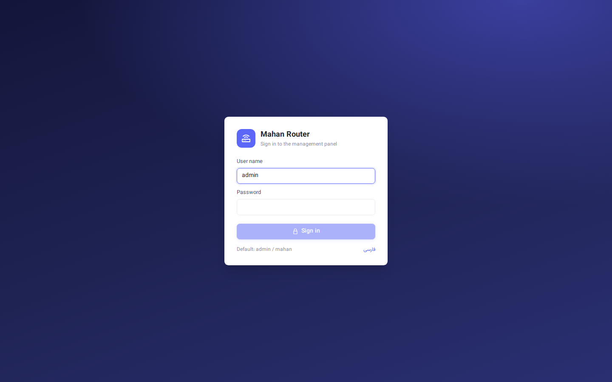
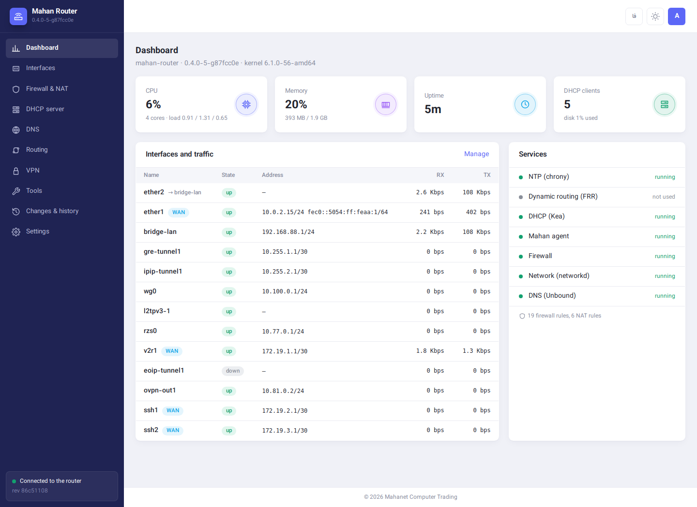
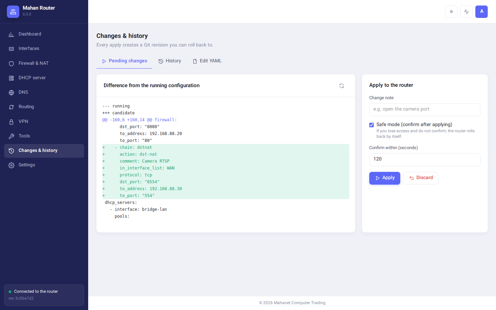
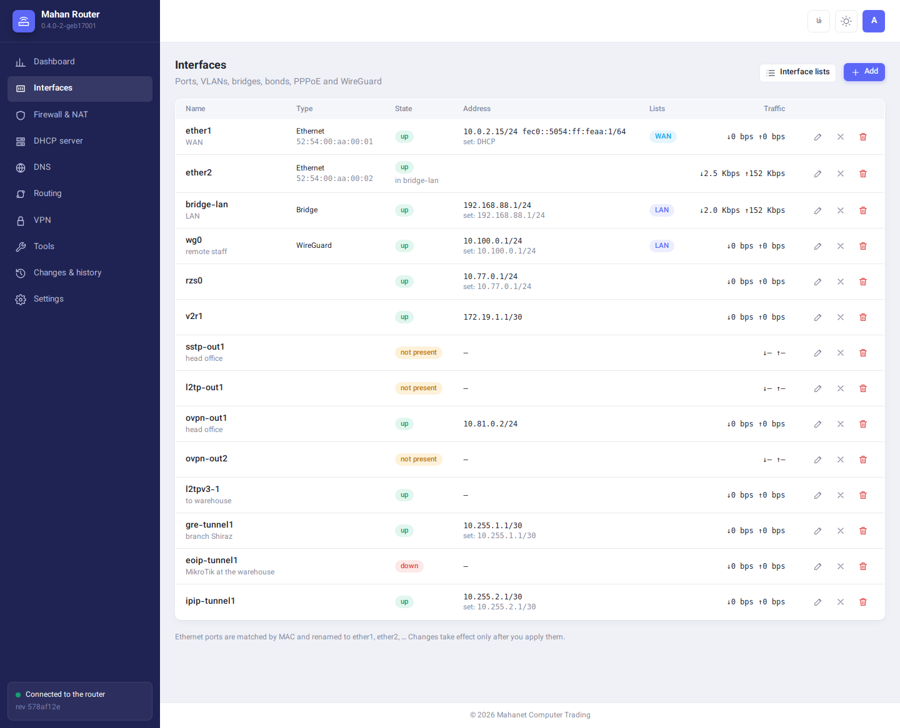
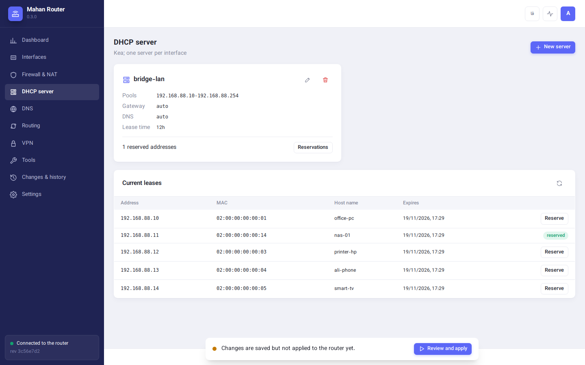
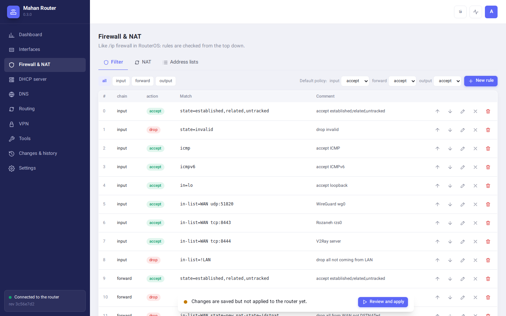
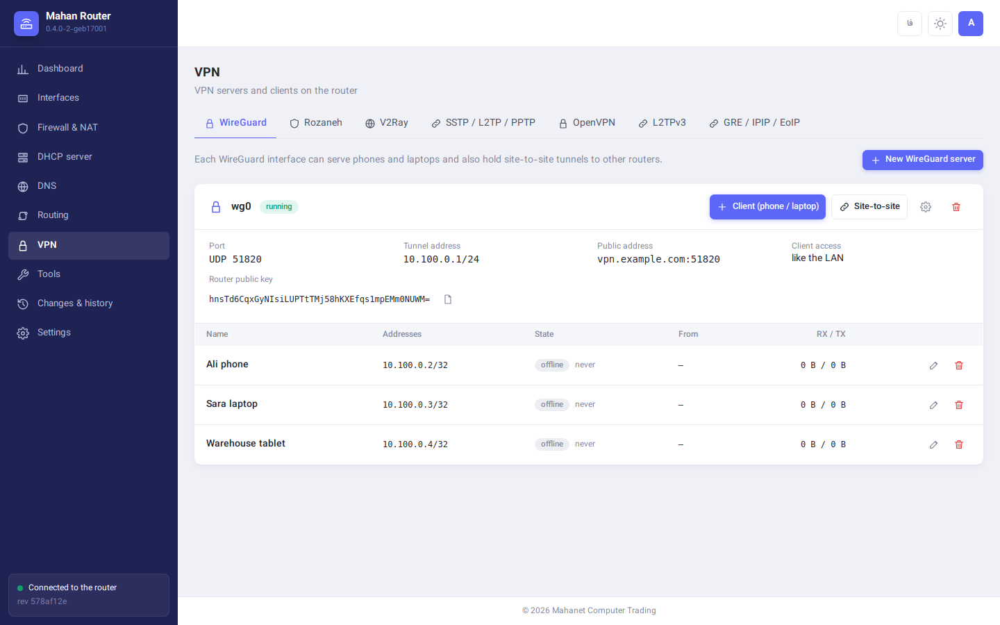
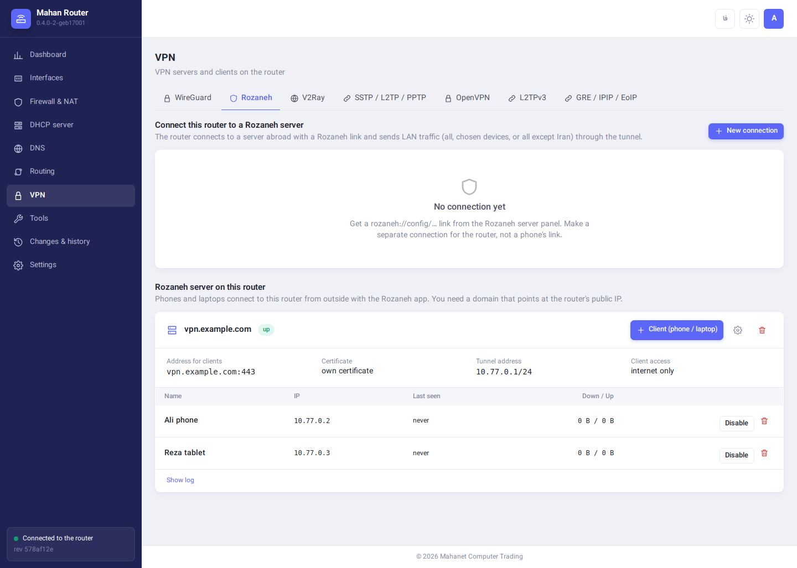
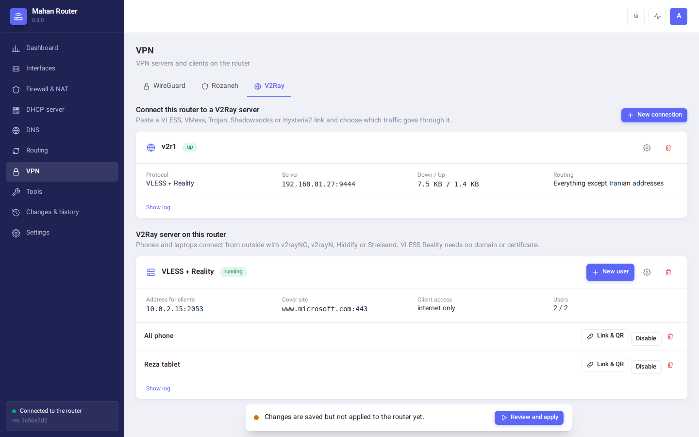
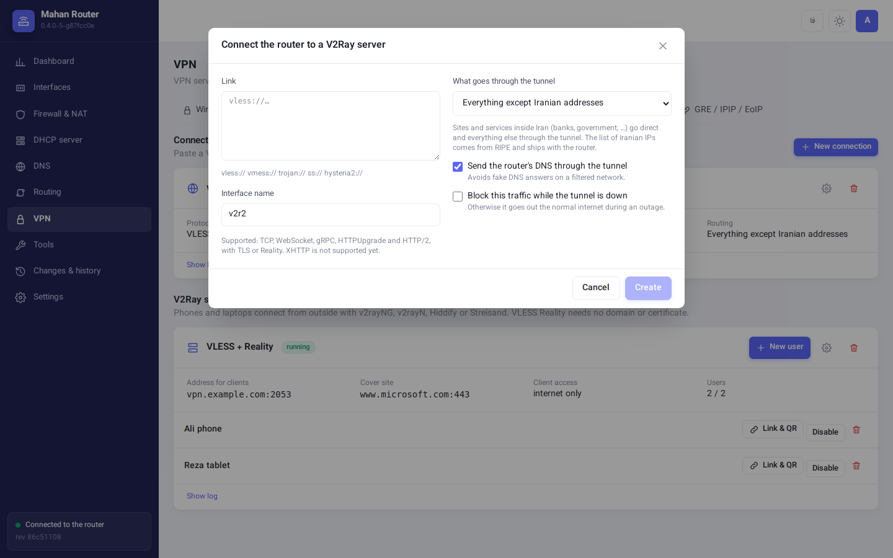

# Installing and deploying Mahan Router

This guide takes you from an empty machine to a working router with a web
panel, internet sharing and, optionally, VPN. The Persian version is in
[INSTALL.fa.md](INSTALL.fa.md).

- [1. What you need](#1-what-you-need)
- [2. Get the ISO](#2-get-the-iso)
- [3. Create the machine](#3-create-the-machine)
- [4. Install to disk](#4-install-to-disk)
- [5. First boot](#5-first-boot)
- [6. Open the web panel](#6-open-the-web-panel)
- [7. How changes are applied](#7-how-changes-are-applied)
- [8. Set up the internet connection (WAN)](#8-set-up-the-internet-connection-wan)
- [9. LAN, DHCP and DNS](#9-lan-dhcp-and-dns)
- [10. Firewall and port forwarding](#10-firewall-and-port-forwarding)
- [11. VPN](#11-vpn)
- [12. Command line and SSH](#12-command-line-and-ssh)
- [13. Backup, history and rollback](#13-backup-history-and-rollback)
- [14. Upgrading](#14-upgrading)
- [15. Troubleshooting](#15-troubleshooting)

## 1. What you need

| | Minimum | Recommended |
|---|---|---|
| CPU | 1 x86-64 core | 2 cores or more (VPN encryption uses CPU) |
| RAM | 1 GB | 2 GB |
| Disk | 8 GB | 16 GB |
| Network ports | 2 (WAN + LAN) | as many as you need; every extra port joins the LAN |
| Firmware | BIOS or UEFI | Secure Boot off |

Tested on:
- VMware Workstation/ESXi (BIOS)
- QEMU/KVM (BIOS and UEFI)

It is a Debian 12 system, so Proxmox, Hyper-V and most x86-64 PCs with
Debian-supported NICs should work as well, but they have not been tested yet.

ARM and MIPS builds of the agent exist, but there is no image for them yet.

## 2. Get the ISO

**Download** it from the [Releases page](https://github.com/ashayesteh86/MahanRouter/releases/latest)
(`mahan-router-<version>-amd64.iso`). Check it against the `.sha256` file
next to it:

```bash
sha256sum -c mahan-router-0.3.0-amd64.iso.sha256
```

**Or build it yourself** on a Debian 12 or Ubuntu 22.04+ machine:

```bash
sudo apt install -y golang-go mmdebstrap squashfs-tools xorriso grub-common grub-pc-bin grub-efi-amd64-bin mtools dosfstools git curl make
```

```bash
git clone https://github.com/ashayesteh86/MahanRouter.git
```

```bash
cd MahanRouter && sudo image/build-iso.sh
```

- You need Go 1.27 or newer; take it from https://go.dev/dl if your
  distribution's package is older.
- The ISO ends up in `dist/iso/mahan-router-<version>-amd64.iso` (about 360 MB).
- The build downloads Debian packages and the pinned sing-box release
  (checked by sha256), so it needs internet.
- **Rozaneh:** Rozaneh, our own VPN protocol, is built only when its source is
  next to this repository (`../mahan-vpn`). Without it the ISO is built
  without Rozaneh. WireGuard and V2Ray are always included.

To test the ISO in QEMU before using it (live boot, LAN client, install, and
boot from disk with BIOS and UEFI):

```bash
sudo image/test-vm.sh all
```

## 3. Create the machine

The order of the network cards matters:

- **The first card is `ether1`, the WAN.** It gets its address by DHCP. Connect
  it to the modem, the upstream network or the internet port group.
- **Every other card (`ether2`, `ether3`, …) is the LAN.** They are bridged
  together as `bridge-lan` with 192.168.88.1/24, a DHCP server, DNS and NAT.

### VMware ESXi / Workstation

| Setting | Value |
|---|---|
| Guest OS | Linux → Debian GNU/Linux 12 (64-bit) |
| CPU / RAM | 2 vCPU, 2 GB |
| Disk | 8–16 GB, SCSI or SATA |
| Firmware | BIOS or EFI, Secure Boot off |
| Network adapters | at least 2, type **VMXNET3** (E1000 also works) |
| CD/DVD | the ISO, with *Connect at power on* |

On ESXi, if a LAN port group has VLANs or more than one client behind the
router, set **Promiscuous mode**, **MAC address changes** and **Forged
transmits** to *Accept* on that port group so the bridge works.

### Proxmox / KVM

Create a VM with OVMF or SeaBIOS and VirtIO disk and network. Add a second
network device for the LAN on its own bridge (`vmbr1`, for example).

### Physical PC

Write the ISO to a USB stick:

```bash
sudo dd if=mahan-router-0.3.0-amd64.iso of=/dev/sdX bs=4M status=progress oflag=sync
```

Boot from the stick. On a PC, ports are numbered in PCI order: the on-board
port is usually `ether1`.

## 4. Install to disk

1. Boot from the ISO. The boot menu starts **Install Mahan Router to disk**
   after 5 seconds.
2. The installer lists the disks. Press **Enter** to take the first one, or
   type its number.
3. Type `YES` to confirm. **Everything on that disk is erased.**
4. When it says so, remove the ISO and press Enter to reboot.

The installer writes an MBR disk with an active partition. It boots with BIOS
and with UEFI.

## 5. First boot

The console shows the addresses you need:

```
  Mahan Router  mahan-router  (tty1)

  Login: root / mahan   (change it with: passwd)
  WAN  ether1     : 203.0.113.10
  LAN  bridge-lan : 192.168.88.1   web panel: https://192.168.88.1
```

- **Console login:** `root` / `mahan`. Change it right away with `passwd`.
- **SSH host keys:** each installation creates its own on first boot.
- **Clock:** it is set from NTP during boot, even if the machine's clock is far
  off, which is common on VMs.

Out of the box the router:
- takes a DHCP address on `ether1`
- serves 192.168.88.10–254 on the LAN
- caches DNS
- masquerades the LAN to the WAN
- blocks every new connection from the WAN, like RouterOS's default firewall

## 6. Open the web panel

Connect a computer to a LAN port. It gets an address from 192.168.88.x. Then
open **https://192.168.88.1**.

1. Accept the browser's certificate warning. The certificate is self-signed
   and created on first start. You can replace it in
   `/etc/mahan-router/panel.{crt,key}`.
2. Sign in with **`admin` / `mahan`**.
3. The yellow bar asks you to change the password. Do it before anything else.
4. The panel is in Persian; the **EN** button at the top switches it to English.





The dashboard shows CPU, memory, uptime and DHCP clients. It also shows every
interface with its address and live traffic, and the state of each service.

## 7. How changes are applied

This is the most important thing to understand:

1. **Every form only edits a *candidate* configuration.** Nothing on the
   router changes yet. A bar at the bottom says there are unapplied changes.
2. **Changes & history → Pending changes** shows the exact difference.
3. **Apply** in *safe mode* (on by default) applies the change. The router
   then waits 120 seconds.
4. **Confirm** in the bar at the top keeps the change. If you lost access and
   cannot confirm, the router goes back to the previous configuration by
   itself. A reboot during those 120 seconds also rolls back.



Every apply is a Git revision. **History** shows them all, with who made each
change. **Roll back** returns to any of them, and **Edit YAML** gives you the
whole configuration as text.

## 8. Set up the internet connection (WAN)

**Interfaces** lists every port. Click the edit icon on `ether1`:

- **DHCP:** the default; nothing to do.
- **Static:** choose *static*, enter the address (for example
  `203.0.113.10/24`), then add a default route under **Routing**:
  `0.0.0.0/0` via your gateway.
- **PPPoE (DSL/fibre):** add an interface of type *PPPoE*, set its parent to
  `ether1`, and enter the username and password. Turn on *add default route*
  and *use peer DNS*. Then put the PPPoE interface in the **WAN** list instead
  of `ether1`.



Interface lists work like RouterOS: firewall and NAT rules use **WAN** and
**LAN**, so you only move an interface between lists.

## 9. LAN, DHCP and DNS

- **Change the LAN address:** edit `bridge-lan`, then fix the pool under
  **DHCP server**.
- **Add more LAN ports:** add them as members of `bridge-lan`.
- **VLANs:** add a *VLAN* interface on a port, give it an address, then add a
  DHCP server for it.
- **DHCP server:** shows the pools and the current leases. **Reserve** turns a
  lease into a fixed address for that device.
- **DNS:** Unbound caches for the LAN and forwards to the servers you choose
  (1.1.1.1 and 8.8.8.8 by default). You can add static host names.



## 10. Firewall and port forwarding

**Firewall & NAT** has the filter chains (`input`, `forward`, `output`) and NAT
(`srcnat`, `dstnat`), each with live hit counters.

- **Port forward:** add a NAT rule with chain `dstnat`, in-interface-list
  `WAN`, protocol, port, action `dst-nat` and the inner address and port.
- **Open a port to the router itself:** add a filter rule with chain `input`
  and action `accept`, and place it *above* "drop all not coming from LAN".
- **Address lists:** use them for allow-lists and block-lists. Rules can also
  fill them dynamically, with a timeout.



## 11. VPN

The **VPN** page has three tabs. All three can work as a server (phones and
laptops connect to the router) and as a client (the router connects to a
server abroad and routes your LAN through it).

> **If your router is behind another router or a modem,** forward the VPN
> port from that device to the router's WAN address. Without it, server mode
> works only from inside that upstream network.

### WireGuard



1. **New WireGuard server** sets the port (51820), the tunnel range and the
   public address (the current WAN IP by default). Keep these two options on:
   - *Open the port in the firewall*
   - *Treat VPN clients like the LAN*
2. **Apply and confirm** on the Changes page.
3. **Client (phone / laptop)** creates a client and shows a **QR code** for
   the WireGuard app and a `.conf` file for Windows/macOS. You choose all
   internet or only the internal network. The client's private key is shown
   once and is not stored on the router.
4. **Site-to-site** connects two routers. Enter the other side's public key,
   endpoint and the networks behind it.

The client table shows who is online, their last handshake, where they connect
from, and traffic.

### Rozaneh

Rozaneh is our own VPN. It looks like ordinary HTTPS to a filtering network,
and falls back to a DNS tunnel during heavy shutdowns.



- **Client:** paste the `rozaneh://config/…` link you got from a Rozaneh
  server. Then choose what goes through the tunnel (see
  [Choosing what goes through a tunnel](#choosing-what-goes-through-a-tunnel)).
- **Server:**
  - You need a domain whose A record points at the router's public IP.
  - The certificate comes from Let's Encrypt automatically; you can paste your
    own instead.
  - TCP 443 is redirected from the WAN to Rozaneh. The web panel stays on 443
    for the LAN.
  - Each client gets a QR code for the Rozaneh app.
  - Anyone who connects without a key sees an ordinary web page.

### V2Ray

The engine is [sing-box](https://github.com/SagerNet/sing-box).



**Client:** paste a share link. These work:
- `vless://`, with TLS or Reality
- `vmess://`
- `trojan://`
- `ss://`, including Shadowsocks 2022
- `hysteria2://`

Transports can be TCP, WebSocket, gRPC, HTTPUpgrade or HTTP/2. XHTTP is not
supported yet.



**Server:**
- **VLESS + Reality** (recommended) needs no domain or certificate. Without a
  key, the port shows the real site you pick as cover, `www.microsoft.com` by
  default.
- **Shadowsocks 2022** is the other option.
- **New user**, then **Link & QR**, gives a link for v2rayNG, v2rayN, Hiddify
  or Streisand. You can show a user's link again at any time.
- Clients only get the internet unless you allow LAN access.

### Choosing what goes through a tunnel

For Rozaneh, V2Ray and the routing of a client tunnel, you choose:

| Option | Meaning |
|---|---|
| All of the LAN | every device on the LAN uses the tunnel |
| Only chosen devices | pick devices from the DHCP list, or type IPs or ranges |
| Everything except Iranian addresses | Iranian sites and services (banks, government, …) go direct; everything else goes through the tunnel. The list of Iranian ranges comes from RIPE and ships with the router. |
| Nothing | the tunnel stays connected but carries no LAN traffic |

Two more options:
- **Send the router's DNS through the tunnel.** A filtering network cannot
  answer with fake addresses this way.
- **Block this traffic while the tunnel is down.** Without it, the traffic
  goes out the normal internet during an outage.

Local, private and multicast addresses, and your static routes, always stay
on their normal path.

## 12. Command line and SSH

SSH works from the LAN; the firewall blocks it from the WAN. Everything the
panel does is also available with `mrctl`:

```bash
mrctl show                       # running configuration
```

```bash
mrctl edit                       # edit the candidate in $EDITOR
```

```bash
mrctl diff
```

```bash
mrctl commit -m "guest vlan" --confirm 120
```

```bash
mrctl confirm
```

```bash
mrctl history
```

```bash
mrctl rollback HEAD~1
```

```bash
mahan-selftest                   # health report of every service
```

To allow SSH from an office network on the WAN, add this rule above "drop all
not coming from LAN" (with `mrctl edit`, or with the firewall page):

```yaml
- { chain: input, action: accept, in_interface_list: WAN, src_address: 192.168.1.0/24, protocol: tcp, dst_port: "22", comment: "SSH from office" }
```

`examples/branch-office.yaml` is a full example with VLANs, PPPoE, WireGuard,
OSPF and port forwards.

## 13. Backup, history and rollback

- The whole configuration is one YAML file, kept in a Git repository in
  `/var/lib/mahan-router`. Every apply is a commit.
- **Backup:** copy the text from *Changes & history → Edit YAML*, or run
  `mrctl show > backup.yaml`.
- **Restore:** paste the YAML into *Edit YAML* and apply, or run
  `mrctl load backup.yaml && mrctl commit --confirm 120`.
- **Roll back:** pick any revision under *History*, or run
  `mrctl rollback <hash>`.

Secrets, such as PPPoE passwords and VPN keys, are part of that file. Keep
backups somewhere safe.

## 14. Upgrading

There is no A/B update yet. To move to a new version:

1. Back up the configuration (see above).
2. Install the new ISO.
3. Load the backup.

On a router you can reach over SSH, replacing `/usr/sbin/mahan-agent` and
`/usr/sbin/mrctl` and restarting `mahan-agent` also works between minor
versions.

## 15. Troubleshooting

| Symptom | What to check |
|---|---|
| LAN clients get no address | On VMware, the bridge takes the MAC of its first port. Check that the LAN port group allows it, or set *Forged transmits* to Accept. Run `ip -br link` on the console. |
| The panel does not open | Use **https://**, from a LAN port. The console shows the LAN address. |
| No internet on the router | Run `mahan-selftest`. Check the clock (`date`): a very wrong clock breaks DNSSEC. It is fixed automatically once NTP answers. |
| A change locked you out | Do nothing. After the confirm timeout the router rolls back by itself. |
| VPN server unreachable from outside | Forward the port on the upstream modem or router. Check the rule counters on the firewall page. |
| A tunnel does not connect | Open its card and click *Show log*. |

Run `mahan-selftest` on the console for a full report of interfaces, services,
the firewall, DNS and the clock.
